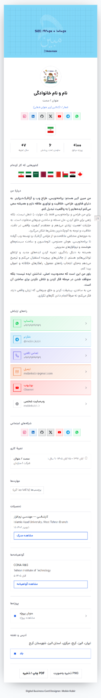

# کارت ویزیت دیجیتال | Digital Business Card

قالبی خودمیزبان برای ساخت کارت ویزیت دیجیتال با PHP، HTML، CSS و JavaScript خالص. این پروژه دارای پنل مدیریت PHP، ذخیره‌سازی اطلاعات در فایل‌های JSON، رابط فارسی و انگلیسی و قابلیت نصب به‌صورت PWA است.

[](README.fa.md) [](README.md)

<p align="center">
  
</p>

## دریافت پروژه

**[دانلود بسته کامل سورس نسخه 1.1.1](releases/digital-business-card-v1.1.1.zip)**

فایل ZIP شامل سورس برنامه، مستندات راه‌اندازی، رسانه‌های نمایشی و اعتبار ورود اولیه مدیر است. اطلاعات پروفایل داخل بسته نمونه و عمومی است و از اطلاعات شخصی نسخه اصلی استفاده نمی‌کند.

## مشاهده دمو و پیش‌نمایش

- [ویدئوی نمایش کارت در موبایل (WebM)](docs/assets/mobile-card-demo.webm)
- [ویدئوی نمایش پنل مدیریت (MP4)](docs/assets/admin-panel-demo.mp4)
- [صفحه تصاویر، ویدئوها و توضیحات رسانه‌ها](docs/PROJECT_MEDIA.md)

## امکانات

- **مدیریت پروفایل:** ویرایش نام، عنوان شغلی، معرفی، مهارت‌ها، آمار و تصویر پروفایل.
- **راه‌های ارتباطی:** افزودن روش‌های تماس، شبکه‌های اجتماعی و لینک‌های اختصاصی.
- **بخش‌های حرفه‌ای:** نمایش سوابق کاری، تحصیلات، گواهی‌نامه‌ها، پروژه‌ها، گالری، موقعیت مکانی و اطلاعات رزومه.
- **پنل مدیریت PHP:** مدیریت محتوای کارت از طریق داشبورد تحت وب.
- **کنترل دسترسی:** ورود مدیر با رمز عبور، بررسی CSRF، مدیریت نشست و محدودسازی تلاش‌های ناموفق ورود.
- **پشتیبانی فارسی و انگلیسی:** رابط دوزبانه همراه با پشتیبانی از تاریخ شمسی و میلادی.
- **شخصی‌سازی:** تغییر قالب و ظاهر بصری کارت.
- **پشتیبانی PWA:** نصب کارت روی دستگاه‌های پشتیبانی‌شده و نمایش نسخه آفلاین از طریق Service Worker.
- **خروجی و چاپ:** ذخیره کارت به‌صورت PNG یا چاپ و دریافت خروجی PDF از طریق مرورگر.
- **بدون نیاز به دیتابیس:** اطلاعات قابل ویرایش در فایل‌های JSON ذخیره می‌شوند.

## فناوری‌های استفاده‌شده

- PHP نسخه 8.1 به بالا
- HTML5 و CSS3
- JavaScript خالص (Vanilla JavaScript)
- ذخیره‌سازی اطلاعات در JSON
- پیکربندی Apache از طریق فایل‌های `.htaccess`
- APIهای Progressive Web App

## راه‌اندازی محلی

1. [بسته سورس پروژه](releases/digital-business-card-v1.1.1.zip) را دانلود و از حالت فشرده خارج کنید.
2. مطمئن شوید PHP نسخه 8.1 یا جدیدتر نصب شده و افزونه‌های `mbstring` و `gd` فعال هستند.
3. ترمینال را در پوشه اصلی پروژه باز کنید.
4. سرور توسعه داخلی PHP را اجرا کنید:

   ```bash
   php -S 127.0.0.1:8080 -t .
   ```

5. نشانی [http://127.0.0.1:8080](http://127.0.0.1:8080) را در مرورگر باز کنید.

صفحه ورود مدیریت در مسیر `/admin/login.php` قرار دارد.

## نصب روی هاست (Apache / cPanel)

1. **انتخاب هاست مناسب:** هاستی انتخاب کنید که PHP نسخه 8.1 یا جدیدتر و وب‌سرور Apache داشته باشد. افزونه‌های PHP با نام‌های `mbstring` و `gd` را فعال کنید. JSON و PHP Sessions نیز باید فعال باشند.
2. **انتخاب مسیر نصب:** در cPanel وارد File Manager شوید. برای دامنه اصلی، پوشه `public_html` و برای نصب در زیرمسیر، یک پوشه مانند `public_html/card/` را انتخاب یا ایجاد کنید.
3. **آپلود و استخراج ZIP:** فایل `digital-business-card-v1.1.1.zip` را آپلود و در مسیر موردنظر Extract کنید. فایل‌هایی مثل `index.html` و پوشه‌های `admin/`، `data/`، `css/`، `js/` و `image/` باید مستقیماً در پوشه مقصد قرار بگیرند؛ مگر اینکه عمداً سایت را در یک زیرپوشه قرار داده باشید.
4. **انتقال فایل‌های مخفی:** مطمئن شوید تمام فایل‌های `.htaccess` نیز منتقل شده‌اند. در File Manager سی‌پنل گزینه **Show Hidden Files (dotfiles)** را فعال کنید. این فایل‌ها برای محدودسازی دسترسی و اعمال تنظیمات Apache ضروری هستند.
5. **تنظیم سطح دسترسی پوشه‌ها:** پردازش PHP باید اجازه نوشتن در پوشه‌های `admin/`، `data/`، `data/uploads/` و `data/resume/` را داشته باشد. ابتدا از سطح دسترسی استاندارد هاست و مالکیت صحیح فایل‌ها استفاده کنید (معمولاً پوشه‌ها `755` و فایل‌ها `644` هستند). فقط در صورت نیاز هاست و با مالکیت درست از `775` استفاده کنید؛ هرگز دسترسی `777` ندهید. اگر ذخیره اطلاعات یا آپلود تصویر انجام نشد، مالک فایل‌ها و کاربر اجرای PHP را از پشتیبانی هاست پیگیری کنید.
6. **فعال‌سازی HTTPS:** گواهی SSL را فعال کنید و سایت را با `https://` باز کنید. برای نصب عادی PWA و عملکرد Service Worker روی دامنه عمومی، HTTPS لازم است.
7. **تست نهایی:** دامنه را باز کنید، وارد مسیر `/admin/login.php` شوید و با اطلاعات پیش‌فرض زیر وارد شوید. بلافاصله رمز عبور را از بخش **امنیت حساب** تغییر دهید. سپس ذخیره کارت، آپلود تصویر و نمایش سایت در پنجره خصوصی مرورگر را آزمایش کنید.

این پروژه برای Apache و استفاده از فایل‌های `.htaccess` آماده شده است. اگر با خطای **500 Internal Server Error** روبه‌رو شدید، گزارش خطای هاست را بررسی کنید و از پشتیبانی بپرسید آیا امکان استفاده از `.htaccess` و ماژول‌های Apache یعنی `mod_headers`، `mod_rewrite` و `mod_expires` فعال است یا خیر. برای رفع خطا، فایل‌های امنیتی را بدون بررسی حذف نکنید.

**نصب در زیرپوشه:** مسیرهای پروژه نسبی هستند و نصب در زیرپوشه نیز امکان‌پذیر است؛ به شرط آنکه ساختار پوشه‌ها کامل منتقل شود و تنظیمات `.htaccess` توسط هاست اعمال شوند.

**نکته مهم:** GitHub Pages فقط فایل‌های ایستا را میزبانی می‌کند و PHP را اجرا نمی‌کند. برای اجرای کامل برنامه باید از هاست دارای PHP استفاده کنید. سرور داخلی PHP فقط برای تست محلی است و برای میزبانی عملیاتی مناسب نیست.

## اطلاعات ورود پیش‌فرض مدیر — تغییر فوری الزامی است

فایل ZIP دانلودی برای ورود اولیه دارای اطلاعات زیر است:

| مورد | مقدار پیش‌فرض |
|---|---|
| نام کاربری | `admin` |
| رمز عبور | `admin` |

<blockquote>
**هشدار امنیتی:** این اطلاعات ورود، عمومی و بین تمام نسخه‌های دانلودی یکسان است. بلافاصله پس از اولین ورود و پیش از در دسترس قرار دادن سایت برای دیگران، رمز را تغییر دهید. هرگز رمز `admin` را روی سایت عملیاتی و عمومی نگه ندارید. حداقل طول رمز جدید در پنل ۶ کاراکتر است؛ پیشنهاد می‌شود رمز اختصاصی و غیرقابل حدس با حداقل ۱۲ کاراکتر انتخاب کنید.
</blockquote>

برای تغییر رمز، وارد پنل شوید، بخش **امنیت حساب** را باز کنید، رمز فعلی را وارد کرده و رمز جدید را ذخیره کنید.

## نحوه ذخیره‌سازی رمز عبور

رمز عبور به‌صورت متن ساده ذخیره نمی‌شود و از رمزنگاری قابل‌بازگشت نیز استفاده نشده است. برنامه با تابع PHP یعنی `password_hash()` و الگوریتم `PASSWORD_BCRYPT` یک هش تصادفی‌سازی‌شده (Salted BCrypt) می‌سازد. اطلاعات ورود در فایل `admin/auth_hash.php` شامل نام کاربری و هش رمز نگهداری می‌شود، نه خود رمز اصلی. هنگام ورود، تابع `password_verify()` رمز واردشده را با هش ذخیره‌شده بررسی می‌کند. با تغییر رمز از پنل، فایل با هش جدید Bcrypt بازنویسی می‌شود. در صورت نیاز، برنامه می‌تواند هنگام ورود هش قدیمی را نیز به‌روزرسانی کند.

فایل ZIP دانلودی یک هش Bcrypt برای رمز پیش‌فرض `admin` دارد. در سورس معمول مخزن Git، فایل `admin/auth_hash.php` به‌کمک `.gitignore` از Commit شدن مستثنا شده تا اطلاعات ورود واقعی سایت ناخواسته وارد مخزن نشود. فایل `admin/.htaccess` نیز دسترسی مستقیم HTTP به فایل‌های اعتبارنامه و کلیدهای محرمانه را در Apache مسدود می‌کند.

## امنیت و حریم خصوصی

- بسته عمومی از اطلاعات نمونه استفاده می‌کند، نه اطلاعات واقعی پروفایل اصلی.
- هش ورود اولیه با یک هش Bcrypt تازه برای اعتبار `admin/admin` جایگزین شده است.
- کلیدهای محرمانه، داده‌های تلاش ورود، فایل‌های شخصی کاربران و رزومه‌های خصوصی در بسته قرار ندارند.
- فونت‌هایی که مجوز بازتوزیع آن‌ها مشخص نبود، حذف شده‌اند.
- بررسی ایستای Syntax فایل‌های PHP و JavaScript، ساختار JSON، مسیرهای Precache سرویس‌ورکر و پاسخ‌دهی پایه مسیرهای HTTP در محیط آماده‌سازی موفق بوده است.
- این پروژه هنوز ممیزی امنیتی مستقل و آزمون کامل استقرار در محیط عملیاتی را پشت سر نگذاشته است.

ویدئوهای نمایشی ارسالی، راه‌های تماس قابل مشاهده روی کارت نمونه را نشان می‌دهند. پیش از استفاده مجدد از این رسانه‌ها در خارج از مخزن، محتوای آن‌ها را بررسی کنید.

## مجوز

به درخواست صاحب پروژه، فایل `LICENSE` در مخزن قرار نگرفته است. عمومی بودن مخزن به‌تنهایی اجازه استفاده مجدد، تغییر یا بازتوزیع سورس را صادر نمی‌کند. کلیه حقوق برای صاحب یا صاحبان قانونی اثر محفوظ است.

## نسخه

**v1.1.1**
