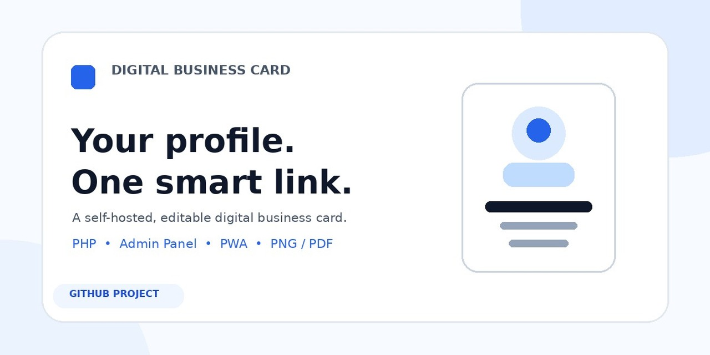

# Digital Business Card

A self-hosted, Persian-first digital business card template with a PHP admin panel, JSON-based content storage, and Progressive Web App (PWA) support.



## Highlights

- Editable profile, biography, skills, contact methods, social links, and custom links.
- Work experience, education, certifications, projects, gallery, location, and resume download sections.
- PHP admin panel with password-protected access, CSRF checks, session handling, and login-attempt throttling.
- Persian-first interface with English support and Jalali/Gregorian date handling.
- Theme and card appearance customization.
- Installable PWA with service-worker caching and offline fallback.
- Save the card as PNG and print or export to PDF through the browser.
- No database required; editable content is stored in JSON files.

## Source package

The complete sanitized v1.1.0 source package is available here:

**[Download digital-business-card-v1.1.0.zip](releases/digital-business-card-v1.1.0.zip)**

The ZIP contains the full project structure and both Persian and English installation documentation.

## Technology

- PHP 8.1+
- HTML5, CSS3, vanilla JavaScript
- JSON file storage
- Apache `.htaccess` rules
- Progressive Web App APIs

## Quick start

1. Download and extract the source package.
2. Open a terminal in the extracted project directory.
3. Run the PHP development server:

   ```bash
   php -S 127.0.0.1:8080 -t .
   ```

4. Open http://127.0.0.1:8080/ in your browser.

The admin page is available at `/admin/login.php`. The public package intentionally does not include an admin account or password hash. See the included README for instructions to create the first admin account securely.

## Requirements

- PHP 8.1 or newer
- `mbstring` and `gd` PHP extensions for image-processing workflows
- JSON and PHP sessions enabled
- Apache recommended for production hosting

> GitHub Pages cannot execute PHP. Use a PHP-capable host to deploy the complete application.

## Security and privacy

- This repository contains sanitized demo content, not the original personal profile data.
- Admin credentials, secrets, user uploads, and private resume documents are excluded.
- The original package's default `admin/admin` credential was removed.
- Fonts with unclear redistribution terms were omitted.
- The project has passed static syntax and JSON checks, but has not undergone an independent security audit.

## License

No `LICENSE` file is included by the project owner's choice. Public visibility does not grant permission to reuse, redistribute, or modify the source; standard copyright restrictions apply.

## Version

`1.1.0`
