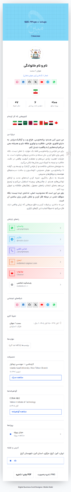

# Digital Business Card

A self-hosted, Persian-first digital business card template with a PHP admin panel, JSON-based content storage, and Progressive Web App (PWA) support.

<p align="center">
  
</p>

## Download

**[Download the complete sanitized source package — v1.1.0](releases/digital-business-card-v1.1.0.zip)**

The ZIP contains the application source and setup documentation. It is a public-ready copy derived from the original project archive; real profile data and the original admin credential hash are not included.

## Project demos

- [Mobile card walkthrough (WebM)](docs/assets/mobile-card-demo.webm)
- [Admin panel walkthrough (MP4)](docs/assets/admin-panel-demo.mp4)
- [Project media and preview](docs/PROJECT_MEDIA.md)

## Features

- Editable profile, biography, skills, contact methods, social links, and custom links.
- Work experience, education, certifications, projects, gallery, location, and resume sections.
- PHP admin panel with password-protected access, CSRF checks, secure sessions, and login-attempt throttling.
- Persian-first interface with English support and Jalali/Gregorian date handling.
- Theme and card appearance customization.
- Installable PWA with service-worker caching and offline fallback.
- Save as PNG and print or export to PDF through the browser.
- No database required; editable content is stored in JSON files.

## Technology

- PHP 8.1+
- HTML5, CSS3, vanilla JavaScript
- JSON file storage
- Apache `.htaccess` rules
- Progressive Web App APIs

## Quick start

1. Download and extract the source package.
2. Open a terminal in the extracted project directory.
3. Run the PHP development server:

   ```bash
   php -S 127.0.0.1:8080 -t .
   ```

4. Open http://127.0.0.1:8080/ in your browser.

The admin page is available at `/admin/login.php`. The public package intentionally does not include an admin account or password hash. Follow the included Persian or English README to create the first admin account securely.

## Requirements

- PHP 8.1 or newer
- `mbstring` and `gd` PHP extensions for image-processing workflows
- JSON and PHP sessions enabled
- Apache recommended for production hosting

> GitHub Pages cannot execute PHP. Use a PHP-capable host to deploy the complete application.

## Security and privacy

- The source download contains generic demo content, not the original profile data.
- Admin credentials, password hashes, secrets, user uploads, and private resume documents are excluded.
- The original package's default `admin/admin` credential was removed.
- Fonts with unclear redistribution terms were omitted.
- The project passed static syntax and JSON checks; it has not undergone an independent security audit.

The supplied demo media intentionally shows the contact details displayed on the sample digital card. Review the preview and recordings before redistributing them elsewhere.

## License

No `LICENSE` file is included by the project owner's choice. Public visibility does not grant permission to reuse, redistribute, or modify the source; standard copyright restrictions apply.

## Version

`1.1.0`
